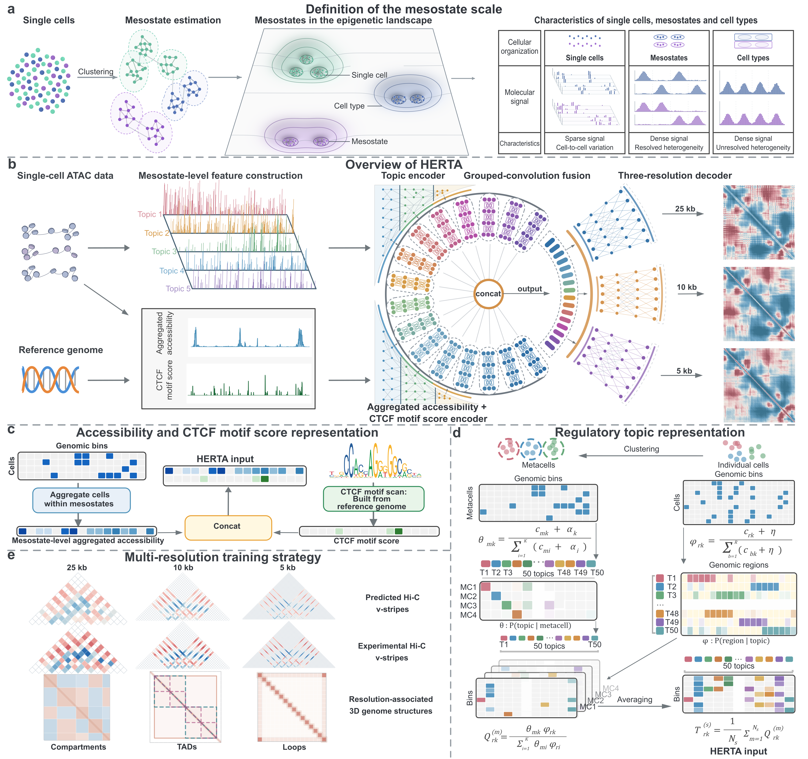

# HERTA

HERTA predicts mesostate-resolved Hi-C contact maps from single-cell ATAC-seq data at 5, 10 and 25 kb resolution. It combines aggregated accessibility, regulatory topic distributions and sequence-derived CTCF motif scores. S2D is an optional enhancement for low-cell-count inputs.

[Installation](#installation) · [Quick start](#quick-start) · [Data and pretrained models](#data-and-pretrained-models) · [Evaluation notebook](evaluate%20and%20visualize.ipynb)



[View the full-size Figure 1](./images/HERTA_overview.png)

## Installation

Run the following commands on Linux with conda and a CUDA-capable GPU:

```bash
git clone https://github.com/BioX-NKU/HERTA
cd HERTA
bash setup.sh
```

| Environment | Use |
| --- | --- |
| `cuda` | HERTA and S2D training and prediction |
| `pycistopic` | Topic dictionary training and inference |
| `archer` | ArchR and HiCDCPlus preprocessing |

[Environment options](env/README.md). Topic processing requires [MALLET 2.0.8](https://mallet.cs.umass.edu/download.php) and a Java 11+ JDK.

## Quick Start

This example uses the released IMR90 inputs and pretrained HERTA checkpoint to predict chromosome 21 at 10 kb resolution.

### Input format

| Input | Format |
| --- | --- |
| Aggregated accessibility | Pickle dictionary with one 50 bp signal array per chromosome |
| CTCF motif scores | Pickle dictionary with one 50 bp score array per chromosome |
| Regulatory topics | NPZ file with a genomic-bin × 50-topic matrix per chromosome at 500 bp resolution |
| Pretrained model | HERTA `.pth.tar` checkpoint paired with the topic dictionary |

The released example uses hg38. Raw fragments, single-cell matrices and Hi-C targets are not needed for this prediction step.

### 1. Organize the input files

Place the IMR90 files listed under [Data and pretrained models](#data-and-pretrained-models) in this structure:

```text
data/
├── atac/imr90_tile_pbulk_50bp_dict.p
├── dna/hg38_ctcf_motif_score.p
├── topic/imr90_topics_aggregated.npz
└── checkpoints/benchmark_gm12878_imr90.pth.tar
```

Use topic features generated with the dictionary paired with the HERTA checkpoint.

### 2. Predict Hi-C contacts

Run from the repository root:

```bash
conda activate cuda
python herta/inference.py \
  --data-path ./data --model-path ./data/checkpoints/benchmark_gm12878_imr90.pth.tar \
  --save-path ./results/predictions -ct imr90 --genome hg38 \
  -chrom 21 --target-resolution 10kb
```

For multiple chromosomes and all three resolutions, use `-chrom 5 15 20 21 --target-resolution all`.

### 3. Read the prediction

The example creates `results/predictions/prediction_imr90_10kb_chr21.npz`:

```python
import numpy as np

with np.load("results/predictions/prediction_imr90_10kb_chr21.npz") as result:
    stripes = result["arr_0"]

print(stripes.shape)  # (number of anchor bins, 400)
```

Each row contains a two-sided V-stripe: 200 values on each side of the anchor at 10 kb resolution. The [evaluation notebook](evaluate%20and%20visualize.ipynb) reconstructs contact matrices from these stripes.

### 4. Visualize and evaluate

For notebook evaluation, place `imr90_hic_dict_10kb.p` in `data/hic/` and create a symbolic link named `imr90_hic_zscore_dict_10kb.p`, which the notebook expects.

Open [evaluate and visualize.ipynb](evaluate%20and%20visualize.ipynb) using the `cuda` environment as its Python kernel. Set these values in its configuration cell, then run the cells in order:

```python
CELL_TYPE = "imr90"
TEST_CHROMS = [21]
RESOLUTIONS = [10000]
PRED_DIR = Path("./results/predictions")
GT_DIR = Path("./data/hic")
OUTPUT_DIR = Path("./results/evaluation")
VIS_CHROM = 21
```

The notebook exports an `imr90_evaluation_summary.csv`, distance-dependent metric curves and contact-map comparisons to `results/evaluation/`.

### Optional: S2D enhancement

For low-cell-count inputs, download the [S2D checkpoint](https://zenodo.org/records/23648055/files/s2d_gm12878_imr90.pth.tar?download=1) into `data/checkpoints/` and run:

```bash
python herta/inference_with_s2d.py \
  --data-path ./data --model-path ./data/checkpoints/benchmark_gm12878_imr90.pth.tar \
  --save-path ./results/predictions_s2d -ct imr90 --genome hg38 \
  -chrom 21 --target-resolution 10kb \
  --use-s2d --s2d-checkpoint ./data/checkpoints/s2d_gm12878_imr90.pth.tar
```

S2D outputs include `_s2d` in the filename. For the notebook, set `PRED_DIR` to the S2D output directory and `PREDICTION_PATTERN` to `"prediction_{cell_type}_s2d_{resolution_kb}kb_chr{chrom}.npz"`.

## Data and pretrained models

The [Zenodo dataset](https://doi.org/10.5281/zenodo.23648055) provides IMR90 inputs and checkpoints trained on GM12878 and IMR90.

| Resource | Files |
| --- | --- |
| Checkpoints | [HERTA](https://zenodo.org/records/23648055/files/benchmark_gm12878_imr90.pth.tar?download=1) · [S2D](https://zenodo.org/records/23648055/files/s2d_gm12878_imr90.pth.tar?download=1) |
| ATAC inputs | [50 bp pseudobulk](https://zenodo.org/records/23648055/files/imr90_tile_pbulk_50bp_dict.p?download=1) · [50 bp single-cell](https://zenodo.org/records/23648055/files/imr90_tile_50bp_dict.p?download=1) · [500 bp single-cell](https://zenodo.org/records/23648055/files/imr90_tile_500bp_dict.p?download=1) |
| Cell barcodes | [50 bp](https://zenodo.org/records/23648055/files/imr90_tile_50bp_barcode.npy?download=1) · [500 bp](https://zenodo.org/records/23648055/files/imr90_tile_500bp_barcode.npy?download=1) |
| Topic input | [IMR90 topic features](https://zenodo.org/records/23648055/files/imr90_topics_aggregated.npz?download=1) |
| Hi-C Z-score targets | [5 kb](https://zenodo.org/records/23648055/files/imr90_hic_dict_5kb.p?download=1) · [10 kb](https://zenodo.org/records/23648055/files/imr90_hic_dict_10kb.p?download=1) · [25 kb](https://zenodo.org/records/23648055/files/imr90_hic_dict_25kb.p?download=1) |
| hg38 reference | [CTCF motif scores](https://zenodo.org/records/23648055/files/hg38_ctcf_motif_score.p?download=1) · [Chromosome sizes](https://zenodo.org/records/23648055/files/hg38.chrom.sizes?download=1) |

Original IMR90 data: [scATAC-seq, ENCSR778RZT](https://www.encodeproject.org/experiments/ENCSR778RZT/) · [Hi-C, 4DNFIH7TH4MF](https://data.4dnucleome.org/files-processed/4DNFIH7TH4MF/).

## Training

<details>
<summary>Train HERTA and the optional S2D module</summary>

Add single-cell ATAC tiles to `/path/to/data/atac/` and Hi-C targets to `/path/to/data/hic/`. This version reads Hi-C targets as `<sample>_hic_zscore_dict_<resolution>.p`; link the downloaded files using:

```bash
ln -s /path/to/downloads/imr90_hic_dict_5kb.p /path/to/data/hic/imr90_hic_zscore_dict_5kb.p
ln -s /path/to/downloads/imr90_hic_dict_10kb.p /path/to/data/hic/imr90_hic_zscore_dict_10kb.p
ln -s /path/to/downloads/imr90_hic_dict_25kb.p /path/to/data/hic/imr90_hic_zscore_dict_25kb.p
```

Pretrain the accessibility/CTCF branch, then train the full model:

```bash
python herta/pretrain.py \
  --data-path /path/to/data --save-path /path/to/results/pretrain \
  -ct gm12878 imr90 --genome hg38 --batch-size 72 --seed 1229

python herta/train.py \
  --data-path /path/to/data --save-path /path/to/results/train \
  --bulk-checkpoint /path/to/pretrained_branch.pth.tar \
  -ct gm12878 imr90 --genome hg38 --batch-size 48 --seed 1229
```

Joint training requires both samples' ATAC inputs, topic features and Hi-C targets. Train S2D with a frozen HERTA checkpoint on two GPUs (0 and 1):

```bash
python herta/train_s2d_low_cell.py \
  --data-path /path/to/data --herta-checkpoint /path/to/benchmark_gm12878_imr90.pth.tar \
  --save-path /path/to/results/s2d -ct gm12878 imr90 --genome hg38 \
  --s2d-gpus 0 --herta-gpu 1 --batch-size 16 --seed 42
```

</details>

## Preprocessing

<details>
<summary>Prepare inputs from raw ATAC-seq and Hi-C data</summary>

### ATAC

Place IMR90 fragments at `/path/to/raw_atac/imr90/fragments.tsv.gz`:

```bash
conda activate archer
CELL_LINE_NAME=imr90 BASE_DIR=/path/to/atac_work \
RAW_DATA_DIR=/path/to/raw_atac CTCF_FILES_DIR=/path/to/references \
GENOME_ASSEMBLY=hg38 CHROM_SIZES_FILE=/path/to/hg38.chrom.sizes \
bash preprocess_atac/fragment_to_input.sh
```

Outputs are in `/path/to/atac_work/imr90_output/atac/` and `dna/`.

### Regulatory topics

Use `Topic50.pkl` and `inferencer.mallet` from the matching dictionary. [Topic preparation and inference](preprocess_atac/preprocess_topic/readme.md) includes the barcode-identity check and commands. Use the aggregated topic matrix from `equal/` for HERTA.

### Hi-C

Example at 10 kb resolution:

```bash
hic_file=/path/to/sample.hic resolution=10000 assembly=hg38 \
workdir_base=/path/to/hic_work \
bash preprocess_hic/hicdcplus_normalization.sh
```

Use `resolution=5000` or `resolution=25000` for the other resolutions.

Place the resulting dictionaries in `/path/to/data/hic/` using the filenames shown under [Training](#training).

</details>

## Acknowledgements

HERTA builds on [ChromaFold](https://github.com/viannegao/ChromaFold), [Hi-Compass](https://github.com/EndeavourSyc/Hi-Compass) and [C.Origami](https://github.com/tanjimin/C.Origami). Evaluation draws on [contact_map_scoring](https://github.com/pollardlab/contact_map_scoring).
